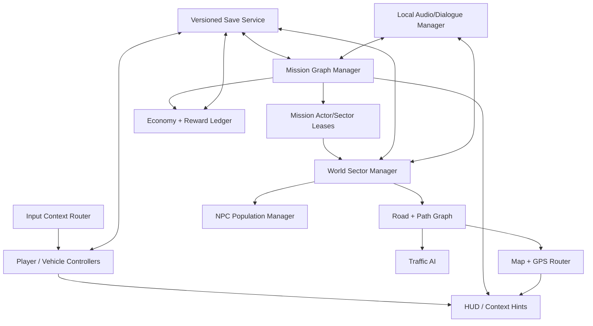

# GTA: San Andreas (2004) — Forensic Research and Original Web-Game Engineering Handbook
**Research snapshot:** 22 November 2026  
**Historical baseline:** PlayStation 2, 2004; the Rockstar-hosted manual inspected here identifies an NTSC U/C disc.  
**New game target:** GTA GHIBLI — standalone Godot 4.7 WebAssembly / WebGL 2, keyboard and mouse.  
**Status:** SUBSTANTIVE PARTIAL RESEARCH + VERIFIED WEB FOUNDATION; NOT A COMPLETE 4,700-ENTRY ENCYCLOPEDIA OR A FINISHED OPEN-WORLD GAME.

## 1. Executive findings and evidence discipline

This handbook separates three kinds of statements:
1. What San Andreas contained or showed in the declared PS2 scope.
2. What developers later said about its production and technical choices.
3. What GTA GHIBLI should build as an original, independently authored Web game.

The evidence gathered is enough to establish several unusually useful engineering lessons. The PS2 manual documents distinct input/control contexts for walking, bicycle, car, first-person weapon use, swimming, helicopter and plane; it also documents map zoom, layer visibility, waypoint placement and radar display. A former technical director later described RenderWare as the engine used for San Andreas. In a separate Q&A, developers described a shared low-detail building system loaded as the player moves, object-count limits in map sections, and a 6 km × 6 km outside-map estimate that excludes interiors. Another retrospective describes an early idea to split the three cities into separate maps, later abandoned in favor of a connected world.

These are not all the same kind of evidence. The manual is an official user-facing PS2 artifact; press releases are official release statements; developer interviews are attributable retrospective testimony; databases and press articles are secondary; engineering equations below are proposals for GTA GHIBLI, not recovered Rockstar code.

## 2. Baseline and version-control rules

### 2.1 Declared baseline

- **Baseline platform:** PlayStation 2.
- **Era:** 2004.
- **Regional evidence in hand:** the Rockstar-hosted PS2 manual says the disc is intended for PlayStation 2 consoles with NTSC U/C designation. This is the clearest regional/build-scope marker used for the manual-derived controls in this first pass.
- **Build ID / executable hash:** UNKNOWN. No retail disc image or executable was acquired or inspected.
- **Capture hardware / emulator:** none. This research pass did not execute a PS2 build or emulator.
- **Rule:** later PC, Xbox, mobile and Definitive Edition facts remain separate.

### 2.2 Release chronology and caveat

| Date | Event | Evidence label | Scope note |
|---|---|---|---|
| 1 Mar 2004 | Rockstar announced San Andreas as a PS2-exclusive title and forecast North American 19 Oct and European 22 Oct street dates. | [CONFIRMED] | Official announcement; these are forecast dates, not proof of actual territory launch. |
| 26 Oct 2004 | Rockstar's current product page lists 26 Oct 2004; GamesRadar's 20th-anniversary article also dates the original release to 26 Oct. | [CONFIRMED]/[SECONDARY] | The page does not provide a detailed per-territory build table. |
| 16 Dec 2004 | Rockstar announced PC and Xbox editions for June 2005. | [CONFIRMED] | This proves the ports were announced after the PS2 launch window, not part of the original PS2 baseline. |
| 7 Jun 2005 NA / 10 Jun 2005 Europe | Official planned street dates for PC and Xbox. | [CONFIRMED] | Dates from the official December 2004 announcement. |
| Later years | Mac, console re-releases, mobile ports and Definitive Edition are listed by current catalogues. | [SECONDARY] | Not audited against a specific build here; never use them as PS2 evidence. |

### 2.3 Version matrix

| Version family | Research treatment | What must not be assumed |
|---|---|---|
| PS2 retail 2004 | Historical baseline; use the NTSC U/C manual where relevant. | Do not claim exact executable build or region-wide parity without a build ID. |
| PC 2005 | Separate version. The 2006 developer Q&A is framed around PC improvements while discussing the San Andreas world system. | Do not copy PC renderer, display or input behavior into PS2 claims. |
| Xbox 2005 | Separate port, announced with PC for June 2005. | Do not assume identical file layout, controller behavior or rendering. |
| Mobile / later console releases | Separate comparisons requiring their own capture/build evidence. | Do not retroactively attribute later fixes, assets or UI to 2004. |
| Definitive Edition | Separate modern re-release. | Visual changes or bugs are not evidence of PS2 implementation. |

## 3. Production history and implementation evidence

### 3.1 Dated timeline

- **1 March 2004 — [CONFIRMED]:** Rockstar announced the project, naming Rockstar North as developer and PlayStation 2 as the exclusive launch platform. Sam Houser and Leslie Benzies described the ambition in the official release.
- **2004 — [CONFIRMED]:** the PS2 retail-era manual documents the user-facing controls, travel, map, services, activities and radio listings.
- **26 October 2004 — [CONFIRMED on current Rockstar page]:** the date currently displayed by Rockstar for the game. Territory-specific launch-day details should be treated cautiously unless matched to a regional retail artifact.
- **16 December 2004 — [CONFIRMED]:** Rockstar announced PC and Xbox releases for June 2005.
- **17 May 2006 — [CONFIRMED as attributed developer testimony]:** GameSpot published a Q&A with Rockstar North developers. Obbe Vermeij described the changed LOD/streaming approach; John Whyte described section object limits, 8-bit indexing structures and the map-size estimate. The Q&A is explicitly framed around the PC version; these statements are treated as developer explanations about San Andreas, with that context retained.
- **6 April 2024 — [CONFIRMED as interview attribution]:** GTABase published an interview with former technical director Obbe Vermeij. He states that GTA III, Vice City and San Andreas used RenderWare, and discusses the later change to RAGE.
- **October 2024 — [SECONDARY]:** GamesRadar reported Vermeij's retrospective explanation that the first proposal placed the three cities on separate maps connected by train and plane travel, partly to reduce PS2 memory pressure; he says the proposal was abandoned after a late meeting.

### 3.2 Credited production roles

The secondary credit transcription separates multiple specialties. The following is a role sample, not a complete credit census and not a reconstruction of reporting lines.

| Discipline / credited role | Named credit(s) | What the credit supports |
|---|---|---|
| Producer | Leslie Benzies | Production role credited on the PS2 game. |
| Art Director | Aaron Garbut | Art direction responsibility is credited. |
| Technical Directors | Adam Fowler, Obbe Vermeij | Technical direction roles are credited. |
| Senior Programmer | Alexander Roger | Senior programming role is credited. |
| Writing | Dan Houser, James Worrall, DJ Pooh | Writing credits. |
| Lead Character Art | Ian McQue | Character-art leadership. |
| Lead Animator / Cutscene Animator | Duncan Shields / Mondo Ghulam | Separate animation specialisms. |
| City art leads | Nik Taylor (Los Santos), Gary McAdam (San Fierro), Adam Cochrane (Las Venturas) | District/city art responsibilities are credited separately. |
| Lead Vehicle Art | Paul Kurowski | Vehicle art leadership. |
| Lead Level Design | Craig Filshie | Level-design leadership. |
| Lead Audio Designer / Music Producer | Allan Walker / Craig Conner | Audio and music leadership are separately credited. |
| QA Tools / QA Manager | Alex Carter / Craig Arbuthnott | Dedicated tools and QA management roles. |
| Lead Mission Analyst / Build Coordinator | David Watson | Mission-analysis and build-coordination role. |

**Boundary:** credits prove a credited role/name pairing; they do not prove team size, task allocation, tools used, reporting hierarchy or which exact assets an individual authored. The MobyGames PS2 page's search result reports 780 people and 930 credits, but that page returned HTTP 403 when opened in this pass. Do not treat the aggregate as an audited full roll.

### 3.3 Runtime and world streaming testimony

The strongest technical clue in this pass comes from the 17 May 2006 GameSpot Q&A:

- Vermeij said a new LOD system allowed multiple building models to share a single low-detail model.
- He said low-detail models could be loaded as the player moved around the map, rather than loading the low-detail content in one go during island changes as in Vice City.
- Whyte said map sections had object-count limits that constrained density; some city sections had effectively maxed out the game as it then existed. He mentioned structures relying on 8-bit indexing.
- Whyte estimated the outside map at 6 by 6 kilometres, excluding many interiors, and said boat/plane travel could take the player beyond populated areas.

**What this proves:** a named developer described streaming/LOD and section-level object ceilings, and provided a world-scale estimate in a post-release Q&A.  
**What it does not prove:** exact PS2 memory pool sizes, exact streaming radius, the full sector file format, precise LOD thresholds, exact object count, source-code structure, or the runtime implementation of each physics/AI subsystem.

### 3.4 Discarded world proposal

GamesRadar's 2024 report reproduces Vermeij's retrospective social post: the original proposal was to put the three cities on separate maps and connect them with trains and planes. The stated motivations included PS2 memory pressure and easier city-specific emergency vehicles, pickups, weather and DVD organization. The plan was abandoned before full map work after a meeting involving Vermeij, Leslie Benzies, Aaron Garbut, Adam Fowler and Alexander Roger, according to the report.

**Interpretation:** the final continuous world is a design/technical trade-off: a connected world creates geographic continuity, but makes residency, visibility, sector budgets and population density harder. The discarded proposal is not the shipped design.

### 3.5 Reconstructed production pipeline — visible evidence boundary

```text
DOCUMENTED ROLES
city art leads ─┐
interior art ───┤
vehicle art ────┤
character art ──┼─> game content and levels (exact transfer steps UNKNOWN)
animation ──────┤
audio design ───┤
programming ────┤
mission analysis┤
QA / tools ─────┘

INFERRED / PROPOSED MODERN REPLACEMENT FOR GTA GHIBLI
brief + schemas
      ↓
source assets + provenance/licence
      ↓
DCC authoring / export validation
      ↓
Godot import + resource checks
      ↓
sector manifests + gameplay data
      ↓
WebAssembly/WebGL2 export
      ↓
Chromium runtime smoke + visual/performance QA
      ↓
temporary measurement → delete local export
```

The top half is a role-based reconstruction from credits only. It is not evidence of Rockstar's actual internal pipeline. The bottom half is a proposed, testable pipeline for GTA GHIBLI.

## 4. What the original game shows about system interaction

### 4.1 Input context is a gameplay system

The PS2 manual separates on-foot, bicycle, car, first-person shooting, swimming, helicopter and plane controls. It gives different uses for attack, sprint, jump, camera, enter/exit, radio, horn, flight pitch/roll and rudder. This is concrete evidence that the player-facing control contract changes with state.

**GTA GHIBLI proposal:** one InputContext owner selects exactly one active mode. The HUD queries that same context, so a vehicle prompt, weapon action and pedestrian interaction cannot all claim the same key at once.

### 4.2 Map planning and local navigation are one loop

The manual explains map access via the pause menu, legend visibility, zoom, moving a target and placing a navigational waypoint which then appears on the radar. It also says map layers such as territory, mission locations and contacts can be hidden.

**GTA GHIBLI proposal:** the map and minimap must share one world-coordinate service and one destination object. The minimap is not allowed to draw an ornamental straight line and call it GPS. A valid route must follow the road/path graph, snap to reachable nodes, recalculate after a blocked edge and report unreachable destinations.

### 4.3 World content, streaming and density

The developer Q&A links local object limits with density and describes shared LOD content streaming. Therefore, a large open world is not simply a large mesh. It is a residency system with budgets, visibility rules and priorities.

**GTA GHIBLI proposal:** divide the world into sectors with explicit manifests for visual meshes, collision, NPC spawn zones, roads, audio ambience and mission pins. Mission-critical actors acquire a residency lease so their sector cannot unload while the mission owns them. Ambient actors may be reduced or despawned under budget pressure.

### 4.4 Character activity and world progression

The manual advertises services and activities including shopping, gambling, grooming, swimming, weights, boxing, martial arts and basketball. This shows the world is more than a mission corridor. The exact PS2 activity counts were not independently enumerated in this pass.

**GTA GHIBLI proposal:** optional activities are independent loops with entry conditions, a clear control context, score/result, reward transaction, exit cleanup and save behavior. Activity completion cannot be allowed to corrupt the main mission state.

## 5. Original-game engineering blueprint for the Web edition

### 5.1 Target and project boundaries

- Engine: **Godot 4.7**.
- Render method: Compatibility / WebGL 2.
- Export: single-threaded WebAssembly.
- Input: keyboard and mouse.
- Current project root: `web-edition/`.
- Current branch: `web/standalone-from-empty-2026-11-22`.
- Current baseline for the branch: `main` at `c9fc82936a43b80af0e3c25eef41c9fee59e47b7`.
- No Android/APK/physical-phone acceptance tests in this Web phase.
- No public hosting or deployment authorized. CI export remains temporary and is deleted.

### 5.2 Proposed dependency architecture



**Authority rule:** each piece of state has one writer. The PlayerController owns player locomotion state; the VehicleController owns vehicle velocity; MissionManager owns mission progress and reward IDs; WorldSectorManager owns residency; SaveService captures a consistent snapshot but does not decide gameplay outcomes.

### 5.3 Data schemas

**World sector**
```json
{
  "schema_version": 1,
  "sector_id": "harbor_docks_01",
  "region_id": "harbor_city",
  "bounds_min": [-256, -20, -256],
  "bounds_max": [0, 80, 0],
  "scene": "res://world/sectors/harbor_docks_01.tscn",
  "asset_manifest": "res://data/assets/harbor_docks_01.json",
  "road_edges": ["road_0001", "road_0002"],
  "spawn_zones": ["civilians_docks_a"],
  "mission_pins": [],
  "resident_priority": 2
}
```

**Road graph**
```json
{
  "schema_version": 1,
  "nodes": [{"id":"r_01","position":[-10,0,0],"sector":"harbor_docks_01"}],
  "edges": [{
    "id":"e_01","from":"r_01","to":"r_02","length_m":85.0,
    "surface":"asphalt","speed_mps":12.0,"direction":"both",
    "lane_count":2,"walkable":true,"drivable":true,"blocked":false
  }]
}
```

**Mission graph**
```json
{
  "schema_version": 1,
  "mission_id": "mission_harbor_002",
  "prerequisites": ["mission_harbor_001"],
  "activation": {"type":"interact","actor_id":"actor_nora_01"},
  "objectives": [{"id":"obj_01","type":"reach","target":"poi_old_pier"}],
  "failure_conditions": [{"type":"actor_dead","actor_id":"actor_guide"}],
  "reward": {"cash":250,"transaction_id":"mission_harbor_002_cash"},
  "actor_leases": ["actor_guide"],
  "sector_leases": ["harbor_docks_01"]
}
```

**Save envelope**
```json
{
  "schema_version": 1,
  "save_id": "slot_01",
  "created_utc": "ISO-8601",
  "world_revision": 1,
  "player": {},
  "vehicle": {},
  "mission_state": {},
  "economy": {"wallet":350,"receipts":[]},
  "world_flags": {},
  "sector_state": {},
  "checksum": "sha256-of-canonical-payload"
}
```

### 5.4 Physics and simulation — proposed model, not Rockstar constants

**Units and tick.** Use meters, seconds, kilograms, radians and Y-up. Authoritative simulation fixed at (h=1/60) s. Rendering interpolates between previous/current physics states using (alpha=	ext{accumulator}/h).

**Integration.** Semi-implicit Euler:
[
v_{n+1}=v_n+a_n h,qquad x_{n+1}=x_n+v_{n+1}h.
]
This is a proposed numerical policy. It is not a statement about San Andreas' engine.

**Body state.** Store position, orientation, linear/angular velocity, mass, center of mass, inertia tensor, collision layer/mask, sleep state and owner ID. Keep visual mesh transforms downstream of physical state.

**Collision.** Broad phase uses sector-aware AABB/spatial hashing. Narrow phase creates contacts with point, normal, penetration depth and relative velocity. Apply normal impulses, Coulomb-limited tangential impulses and bounded positional correction. Use CCD for fast vehicles and small moving objects where tunnelling is observed.

**Character.** A CharacterBody3D controller owns movement velocity. Compute camera-relative direction, acceleration, braking, slope policy, grounded state and jump requests; then call move_and_slide once per fixed tick. Animation follows measured velocity and grounded state, never the other way around unless a specific authored root-motion handoff is declared.

**Arcade car.** For a first Web sedan, use longitudinal speed (v), throttle (u), brake (b) and steering angle (delta):
[
a_x = u,a_{max} - operatorname{sign}(v)b,b_{max} - c_d v|v|,
]
[
dotpsi = rac{v}{L}	an(delta),g,
]
where (L) is wheelbase and (gin[0,1]) is a grip modifier. This simple kinematic model is easy to test but does not reproduce tire load transfer or suspension. A later rigid-body vehicle should add wheel contact, suspension, tire slip and rollover.

**Suspension proposal.** Each wheel applies
[
F_s=operatorname{clamp}(k,x-c,dot x,0,F_{max}),
]
where (x) is compression. Apply spring force at the wheel contact point to generate chassis pitch/roll moments.

**Grip proposal.** Limit combined longitudinal/lateral tire force to a friction circle:
[
sqrt{F_x^2+F_y^2}leq mu F_z.
]
Reduce grip under wet/loose surfaces by changing (mu), not by teleporting the vehicle.

**Water/air/rail.** Water: buoyancy approximation (F_b=
ho gV_{submerged}), with drag against relative water velocity. Aircraft: (L=rac12
ho v^2 S C_L(alpha)) with bounded angle-of-attack and explicit stall fallback. Rail: project onto a track spline and constrain lateral offset. These are proposed arcade models requiring isolated tests.

**Objects and damage.** Impacts emit one event containing entity IDs, contact point, normal impulse, material and timestamp. Damage systems consume the event once. Debris is pooled, bounded and owned by a sector; cleanup must run on sector unload.

**Streaming.** Mission-owned actors and sectors use explicit leases. Distant ambient actors may be updated less often; do not lower the update rate for mission-authoritative physics. Saves persist stable logical state and omit transient contacts.

### 5.5 System acceptance tests

| System | Reproducible test | Pass criterion |
|---|---|---|
| Player locomotion | Hold W for 2 s, turn camera while moving, release W. | Movement follows camera-relative axes; camera input never rotates by itself after release. |
| Camera obstruction | Walk backward toward a wall and turn near a corner. | Camera retracts without passing through the wall or changing player velocity. |
| Vehicle handoff | Enter sedan; drive; attempt exit with both sides blocked. | No player teleport into collision; controller remains in vehicle until a valid exit reservation exists. |
| Road graph | Route between two nodes in different sectors; close one edge. | Path follows edges and recalculates or reports unreachable. No straight-line GPS through buildings. |
| Traffic | Spawn two opposing vehicles at a narrow junction. | Junction reservation prevents overlap; blocked actor yields or reroutes. |
| Pedestrians | Walk through a civilian path and approach a crowd. | Actors avoid obstacles and each other without leaving navigation bounds. |
| Mission retry | Fail a mission after spawning its actors; retry twice. | One active actor set; one reward receipt; no stale HUD objective. |
| Mission actor streaming | Move beyond an otherwise unloadable actor's sector during mission. | Sector lease keeps mission actor valid; ambient actors can still unload. |
| Save during transition | Request save while an interior transition/cutscene is in progress. | Save is deferred or uses a consistent transition ticket; no half-loaded world state. |
| Load supersession | Load save with different active objective. | Old HUD objective is discarded and replaced by the loaded authoritative state. |
| Density stress | Increase traffic/pedestrians in one district to configured cap. | Spawn budget clamps; telemetry reports pressure; no unbounded memory growth. |
| Browser network | Run on localhost while logging requests. | No runtime request to external hosts. |
| Export | Run Godot Web export, inspect HTML/JS/WASM/PCK. | All export files exist and WebGL2 canvas starts in Chromium. |

### 5.6 Exact difficult integration event ordering

**Mission NPC enters sector that would unload**
1. MissionManager emits `mission_actor_required(actor_id, sector_id)`.
2. WorldSectorManager increments that sector's mission lease count.
3. Sector load completes and emits `sector_ready`.
4. NPC manager transfers actor from ambient schedule ownership to mission lease ownership.
5. Mission logic may now issue movement/dialogue commands.
6. On mission cleanup, NPC manager restores ambient schedule or destroys the actor according to mission result.
7. WorldSectorManager releases the lease and may unload only after no other lease/player/camera/vehicle dependency remains.
Invariant: no mission-owned actor is destroyed by distance-only cleanup.

**Mission finishes while player is driving**
1. Mission objective event arrives with unique mission instance ID.
2. MissionManager validates current state and records the completion transition.
3. Reward ledger checks transaction ID and writes one receipt.
4. MissionManager commits progression and emits objective/reward signals.
5. HUD refreshes mission text while retaining vehicle-control context.
6. SaveService serializes player-in-vehicle relation and vehicle transform together.
Invariant: the mission cannot switch to on-foot HUD or clear the vehicle owner unexpectedly.

**Blocked vehicle exit**
1. Player requests exit.
2. VehicleController proposes left/right exit transforms.
3. Physics queries test player capsule plus margin at each candidate.
4. If one candidate is clear, reserve it and freeze vehicle seat ownership for the handoff tick.
5. Transfer camera/input/player transform.
6. Commit occupant release.
7. If neither candidate is clear, cancel without detaching the player.
Invariant: no overlap and no lost occupant state.

**Save requested during cutscene/transition**
1. SaveService receives request.
2. It queries a safe-state gate.
3. If transition is non-atomic, queue request until a stable checkpoint; otherwise write a transition ticket and both origin/destination IDs.
4. Serialize authoritative states and checksum.
5. Commit temporary save then replace previous slot.
Invariant: a failed write leaves the prior valid save intact.

**Loaded state supersedes old HUD**
1. SaveService parses and validates version/checksum.
2. Migration runs before any runtime objects receive state.
3. MissionManager, PlayerController, VehicleManager and WorldSectorManager apply state.
4. Each owner emits its authoritative state-changed signal.
5. HUD unsubscribes stale bindings and renders new state.
Invariant: UI never writes progression or vehicle state back into owners.

**Retry a failed mission**
1. MissionManager closes current instance and marks failure reason.
2. MissionActorLease releases actors and sector pins.
3. Reward transaction is not committed unless success state was reached.
4. Cleanup removes mission-owned transient objects and markers.
5. Retry creates a new instance ID and fresh actor leases.
6. Existing idempotency key prevents payout duplication.
Invariant: only one active mission instance owns each mission actor.

**Traffic overload**
1. Sector manager reports traffic budget pressure.
2. TrafficManager stops new ambient spawn tickets.
3. Distant traffic switches to low-frequency update or simplified path proxy.
4. Mission-critical vehicles remain full simulation.
5. Telemetry records frame time and budget actions.
Invariant: density reduction does not destroy mission-required agents.

**Ambient NPC becomes mission-controlled**
1. MissionManager requests actor by stable ID or spawns a new mission actor.
2. NPC manager snapshots ambient state and issues mission lease.
3. Mission AI takes control; ambient schedule is suspended.
4. On release, restore saved schedule if still valid, otherwise return actor to generic ambient pool.
Invariant: exactly one system owns the actor brain at any tick.

## 6. Character census — initial evidence subset only

The official PS2 manual's front matter explicitly names four characters in a short character panel:
- **Carl Johnson (CJ)** — identified as recently arrived from Liberty City; the manual also says his appearance can change.
- **Lance Wilson (Ryder)** — alias/canonical-name pairing appears in the panel.
- **Melvin Harris (Big Smoke)** — alias/canonical-name pairing appears in the panel.
- **Sean Johnson (Sweet)** — alias/canonical-name pairing appears in the panel; the manual identifies him as Grove Family leader.

This is not a complete census. These entries satisfy the narrow test of being named in the inspected PS2 manual, not the requested exhaustive individual/voice-only/mentioned-only census. No ambient ped archetype has been counted as a named character. No repeated model has been merged into a person. A complete census needs end-credit capture, mission-by-mission dialogue/character index, radio-personality index and a named-build verification pass. The 58-character figure on a current fan database is not adopted as a verified PS2-only total.

## 7. Asset and data catalog — what is and is not established

| Domain | Evidence in this pass | Status for 2004 PS2 |
|---|---|---|
| Character art / animation | Lead character art and animation roles appear in a secondary credit transcription. | Role evidence; specific file formats and rig structure UNKNOWN. |
| City/interior/vehicle art | Separate city art leads, interior art and vehicle art roles are credited. | Role evidence; original DCC packages and export rules UNKNOWN. |
| LOD / streaming | Developer described shared low-detail building models loaded as player moves. | Attributed architecture clue; underlying asset file layout UNKNOWN. |
| Mission data / scripts | Mission analyst and programmers are credited. | Specific script language, data format and mission authoring tools UNKNOWN. |
| Road/nav data | A map, waypoint and radar are documented in the manual. | Runtime road graph representation UNKNOWN. |
| Audio | Audio design/programming, music production, voice-over and dialogue editing roles are credited. | Exact middleware, codecs and mix pipeline UNKNOWN. |
| QA tools | QA tools role and test/build coordination roles appear in credits. | Tool names and internal test suite UNKNOWN. |
| File formats | No PS2 disc image or executable was inspected. | Do not claim exact IMG/IDE/IPL/TXD/DFF file evidence in this pass. Those require direct archive and version verification. |

No proprietary game assets are redistributed by this research package.

## 8. Research trail and unresolved questions

### Queries and source groups used
- Official publisher/Take-Two press announcements for project announcement and port chronology.
- Rockstar's current product page for public synopsis and displayed date.
- Rockstar-hosted PS2 manual PDF for the NTSC U/C statement, controller modes, map/waypoint controls, activities/services and character panel.
- GameSpot's 2006 developer Q&A for LOD streaming, map sections, object limits and world-scale testimony.
- GTABase's 2024 interview with Obbe Vermeij for RenderWare and technical recollection.
- GamesRadar's 2024 report for the discarded separate-city proposal and PS2 memory context.
- Current secondary catalogues for version/context checks only; aggregate counts not treated as PS2-only facts.

### Access limitations
- The PS2 manual text was extracted and searched. A screenshot request failed because the PDF download was 14,709,483 bytes and exceeded the screenshot tool's size limit; no visual page screenshot is claimed.
- MobyGames' dedicated PS2 credits page returned HTTP 403 in the direct open attempt. Search-indexed text was available, but the full page was not independently inspected.
- Rockstar's current product page returned no readable body lines when opened; its search result surfaced the official description/developer/date.
- No retail disc, emulator, PS2 hardware, game capture, source code, original production asset archive or private studio tooling was accessed.
- No original physics constants, exact LOD distances, sector memory budgets, spawn caps, build hash, script language or character-census total were established.

### Evidence that would settle open questions
- A region/build-identified retail PS2 disc and executable hash.
- A full legal gameplay capture with timestamped route and controller inputs.
- Complete end-credit roll and mission/cutscene transcript for named-character census.
- Attributable developer talks or archived source documents showing tools, streaming structures and memory budgets.
- Directly inspected PS2 assets/data with an independently documented extractor and checksums.

## 9. Windows Command Prompt (cmd.exe)

Replace the Godot path and project path with the real locations on the Windows computer. The following commands are for the repository's current Web project, not a fictional research executable.

```cmd
set "GODOT_EXE=C:\Godot\Godot_v4.7-stable_win64.exe"
set "PROJECT_DIR=C:\Games\GTA-GHIBLI\web-edition"
cd /d "%PROJECT_DIR%"
"%GODOT_EXE%" --version
"%GODOT_EXE%" --editor --path "%PROJECT_DIR%"
```

Run the main scene:

```cmd
"%GODOT_EXE%" --path "%PROJECT_DIR%"
```

A compatible headless foundation test exists at `res://tests/web_foundation_test.gd`:

```cmd
"%GODOT_EXE%" --headless --path "%PROJECT_DIR%" --script "res://tests/web_foundation_test.gd"
```

Export the Web preset after installing the matching Godot 4.7 export templates:

```cmd
if not exist "%PROJECT_DIR%\build\web" mkdir "%PROJECT_DIR%\build\web"
"%GODOT_EXE%" --headless --path "%PROJECT_DIR%" --export-release "Web" "%PROJECT_DIR%\build\web\index.html"
```

Serve the export from an HTTP local server; do not open the HTML through `file://`. The repository's CI browser server is bound to `127.0.0.1` and is not a public hosting service.

## 10. Completion audit for this package

| Requirement | Required | Actually delivered in this first research package | Missing |
|---|---:|---:|---:|
| Core parent details | 50 | 50 | 0 |
| Core numbered elements | 2,250 | 50 (one per parent) | 2,200 |
| Graphics parent details | 50 | 50 | 0 |
| Graphics numbered elements | 2,250 | 50 (one per parent) | 2,200 |
| Overlooked details | 100 | 20 | 80 |
| Overlooked elements | 100 | 20 | 80 |
| Physics records | No cap | 18 proposed systems | Full version-specific audit and full set of tests still missing |
| Character records | Evidence-complete census | 4 manual-named entries | Exhaustive named/voice-only/referenced/unnamed-role census missing |
| Verified overflow | As needed | 0 | None admitted without verified evidence |
| Runnable Web project | Complete vertical slice in prompt | Existing playable foundation only | Traffic loop, pedestrian activity, mission fail/retry, complete save, debug test scene and full slice not yet present |
| Machine-readable registry | JSON or CSV | JSON delivered | Validator still reports expected incomplete counts |
| Research helper | Local tool if required | Local-only helper source delivered beside this document | No web retrieval, no automatic PDF/DOCX parsing, no guarantee of exhaustive coverage |

**Missing ID ranges**
- Core: for every parent `CORE-01` … `CORE-50`, IDs `.02` through `.45` are missing: 50 × 44 = 2,200.
- Graphics: for every parent `GFX-01` … `GFX-50`, IDs `.02` through `.45` are missing: 50 × 44 = 2,200.
- Overlooked details: `EXTRA-D-021` through `EXTRA-D-100` are missing: 80.
- Overlooked elements: `EXTRA-E-021` through `EXTRA-E-100` are missing: 80.

No missing entry is silently represented by a heading, placeholder or duplicate. The registry validator computes these gaps from the actual JSON contents.